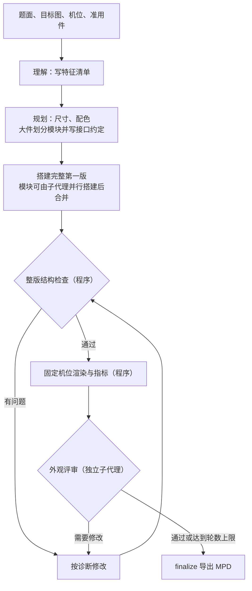

# 代理搭建流程总设计

**目标设计，待实施。** 本文给出从理解需求到交付模型的整体方案，P-004 至 P-006 由此派生。
各提案只写各自的实现、备选和验收，引用本文的小节而不重复。实施完成后，本文改写为现状说明。
对外的客户版设计稿另存于本地，与本文的流程一致。[范围](../decisions.md#u-06--以-omr36-演示完整搭建流程) · [模型](../decisions.md#u-07--演示统一使用-gpt-62-sol-medium)

## 1 目标与范围

在 OMR36 BrickWright 从零版第二版的六道题上演示完整流程：理解需求、规划、搭建、结构检查、外观评审、交付。
流程针对三项目标。

1. **装得对、装得上。** 零件按正确方式咬合，没有碰撞、悬空或未接上的部分。
2. **看得像。** 保留参考图和题面中让人认出对象的特征。
3. **大件能分块。** 大模型按接口约定拆成模块，可并行搭建后合并。

演示由 Codex 0.170.0 通过 `brickwright external` 驱动。主代理、子代理和评审代理均使用 `gpt-6.2-sol`，推理强度 medium。

本轮不做 LijuBrick 接入、真实照片输入和客户案例验收。实物的结构强度和拼装顺序不在检查范围内。
领导提出的“在限制模型能力的前提下”改善效果，本轮演示不能直接证明，见[第 10 节](#10-风险与起草前检查)。

## 2 评测与验收

评测集为工作区的 `brick-workspace/build/omr36-brickwright-v2`，六题均已通过 Maestro Oracle。
每题给出题面、五张固定机位目标图、`cameras.json`、准用件及色号表和件数上限。
`task.json` 的 `checks` 列出题面的完成条件。

| 题目 | 件数上限 | 参考解件数 | 参考解连通组件 |
| --- | --- | --- | --- |
| R-5521 Sea Jet 快艇 | 500 | 395 | 4 |
| R-21011 勃兰登堡门 | 460 | 362 | 1 |
| R-21020 特雷维喷泉 | 920 | 730 | 1 |
| R-31038 四季小屋 | 690 | 545 | 19 |
| R-31039 蓝色动力喷气机 | 770 | 613 | 1 |
| R-10258 伦敦双层巴士 | 2110 | 1684 | 14 |

独立验证器先做交付检查，包括定稿记录的悬空与碰撞校验、准用件与颜色、位姿和件数上限。
通过后，平台分取五个机位上同色前景像素占并集比例的均值，并保留逐视图轮廓交并比和颜色分。

**对照方式。** 基线为当前 `develop` 的外部代理流程，新版为实现本设计后的流程。
两版使用相同的 Codex 版本、模型、推理强度、时限和每题运行次数，运行前冻结这些设置和评分规则。
第二版原定的 20 分钟时限不够完成特雷维喷泉，因此另传一个只改时限的版本：每题 1 小时，巴士 2 小时。
基线已用 `develop` 594effd 在该版本上每题运行一次。[基线运行](http://localhost:8420/runs/run_01m834xe645ngv8jjcmc40svmx)
新版只更换 BrickWright 附件，题目版本不变，以便按题对齐比较。
逐题记录以下内容。

- 交付检查是否通过，平台分，逐视图轮廓交并比和颜色分。
- 题面完成条件逐条的人工判定。
- 结构报告中主体以外的组件和仅靠接触支撑的零件（[第 6 节](#6-整版结构检查)）。
- 总耗时、模型用量，以及结构返修和外观返修的轮数。

拟议的通过条件如下，具体阈值在冻结设置时确定。新版交付通过率不低于基线，平台分均值和完成条件的满足数不低于基线。
每版每题只跑一次时看不出波动，正式对照每版每题至少跑两次。
伦敦双层巴士另跑一组分块搭建，合并后通过交付检查，计入合并和返工后的总耗时短于同题整体搭建。

**基线结果。** 六题全部通过交付检查，平台分均值 0.568。代理用时 15.6–22.2 分钟，都未触及时限。

| 题目 | 交付件数 | 平均轮廓交并比 | 平台分 | 用时（分钟） |
| --- | --- | --- | --- | --- |
| R-5521 Sea Jet 快艇 | 282 | 0.852 | 0.414 | 15.6 |
| R-21011 勃兰登堡门 | 349 | 0.997 | 0.958 | 15.7 |
| R-21020 特雷维喷泉 | 881 | 0.968 | 0.702 | 21.2 |
| R-31038 四季小屋 | 544 | 0.918 | 0.524 | 22.2 |
| R-31039 蓝色动力喷气机 | 757 | 0.795 | 0.329 | 19.7 |
| R-10258 伦敦双层巴士 | 1007 | 0.860 | 0.482 | 19.0 |

结果说明以下几点。

- **结构已不是失分点。** 每个代理都自行加了连通性测试，六件成品都连成一体，悬空和碰撞为零。
  只有勃兰登堡门用到了按连接放置，其余都按坐标放置。本设计的结构检查在这组题上主要防止退步，难以体现提升。
- **失分集中在外观。** 成品都能认出，但平台分要求同色像素逐点重合，形状偏移几个凸点就会失分。
  例如喷气机题面要求外倾双尾翼，成品做成了竖直的阶梯状平板；巴士缺少前部的发动机罩和圆角车头。
  这些正是特征清单和逐项评审要抓的问题。基线代理不能按题目机位渲染，也没有调用评审。
- **勃兰登堡门接近上限，** 主要用于检查新流程不退步。
- **时限足够。** 特雷维喷泉用了 21.2 分钟，原定的 20 分钟确实不够。新流程增加评审轮次，1 小时仍有余量。

## 3 入口与共享层

BrickWright 有两条代理入口。`brickwright generate` 由内置循环经 LiteLLM 调用模型，
`brickwright external` 供 Codex、Claude Code 等外部代理调用。两者共用 BrickLayer、生成记录、
验证与导出工具、诊断和知识库。[架构](../architecture/overview.md)

本设计的新能力放在共享层。新产物存为记录中的文件，读写经过同一套校验。放行条件在记录和 `finalize` 中检查。
阶段顺序分别写入外部代理的流程说明和内置代理的提示，两条入口都能走完整流程。
演示只用外部入口，内置入口保持工具一致，不作为本轮验收对象。

记录在创建时选择是否启用本流程。未启用的记录和历史记录按现有规则验证和导出，
上游已有的视觉评审循环保持可用。

Codex 0.170.0 带有 `spawn_agent` 和 `wait_agent` 子代理工具，由多代理开关控制。
评审代理和模块搭建依赖它开启独立上下文。现有的[外部视觉评审说明](../../packages/brickwright/src/brickwright/driver/external_critique.py)已要求外部代理自行派出子代理。

## 4 流程与放行条件

| 阶段 | 执行者 | 产出 | 放行条件 |
| --- | --- | --- | --- |
| 理解 | 主代理 | 特征清单 | 格式有效；题面每条完成条件至少对应一项特征 |
| 规划 | 主代理 | 规划与接口约定 | 格式有效；有模块时各模块占用范围不重叠，接口两端都有归属 |
| 搭建 | 主代理，可加模块子代理 | `build.py`，模块记录 | 能创建模型 |
| 结构检查 | 程序 | 整版结构报告 | 无碰撞、无悬空，非主体组件均已声明或判定为数据缺项，模块接口对齐 |
| 外观评审 | 程序渲染，子代理评审 | 指标和评审报告 | 评审绑定当前源码和特征清单；结论为通过，或已用完评审轮数 |
| 交付 | 程序 | LDraw MPD、预览 | 以上条件对当前源码全部成立 |

结构检查必须先于外观评审。修改 `build.py` 会使结构报告和评审失效，修改特征清单会使评审失效。
每次外观修改都要重新通过结构检查。评审轮数沿用现有外部评审的默认上限两轮，可按任务配置。
达到上限时可以交付，评审报告保留未解决的特征项。

外部代理可随时查询记录的流程状态。状态列出各产物是否存在、是否对应当前源码、哪项条件阻止导出，以及下一步可执行的命令。
`finalize` 被流程条件拒绝时，返回带原因码的诊断，格式与现有执行诊断一致。[代理收到的诊断](validation-and-export.md#代理收到的诊断)

## 5 记录中的新产物

现有记录已有 `build.py`、元数据、验证报告、快照、渲染图和视觉评审结果。[记录](../../packages/brickwright/src/brickwright/record.py)
本流程新增四类产物，均为 JSON 并带版本号，写入时校验格式，具体字段在提案中定稿。

**特征清单。** 每项包含编号、名称、类别（保留或有意简化）、重要度（必须或尽量）、描述、依据和理由。
依据指向题面的完成条件或某张目标图及图中位置。有意简化的项写明简化方式，例如“侧墙小窗合并为三扇”。

**规划。** 包含整体尺度（目标包围范围，单位 LDU）、配色、有意分离的组件，以及可选的模块划分。
每个模块写明编号、占用范围、在整体中的原点和朝向、接口和共用颜色。
每个接口写明两端模块、连接类型、连接点在整体坐标中的位置和方向。

**结构报告。** 在现有验证报告上扩展，见[第 6 节](#6-整版结构检查)。

**评审报告。** 绑定源码摘要和特征清单摘要。包含逐视图指标、差异区域，以及逐项特征结论。
每项结论为保留、部分保留、缺失或已按约定简化，附图上证据和修改建议。最后给出“通过”或“需要修改”。

## 6 整版结构检查

现有验证在一次运行中检查碰撞和悬空，并执行记录自带的测试。悬空判定把接触支撑也算作有支撑，因此放在其他零件上而没有咬合的零件不会被报告。[验证实现](../../packages/brickwright/src/brickwright/tools/validation.py) · [悬空与连通组件](../../packages/bricklayer/src/bricklayer/modeling/build.py)

在本版 `develop` 上检查六题参考解，悬空和碰撞均为零，最大的巴士用时 1.4 秒。
但三题参考解不是单一连通组件：巴士有 14 个，四季小屋 19 个，Sea Jet 4 个。
初步查看，这些组件包括人仔部件、车内小件和挡风玻璃附件，尚未逐件区分端点数据缺项和有意的接触摆放。
因此“必须连成一体”不能作为放行条件。

整版结构检查保留碰撞和悬空两项放行条件，新增下列报告。

- **未咬合的组件。** 列出主体以外的每个连通组件，给出件数、包围范围、与主体的接触零件。
  组件含缺少端点数据的零件时标为数据缺项，并给出 `lookup_part` 的查询结果。
  规划中声明为有意分离的组件不计为问题，其余组件阻止导出。
- **仅靠接触支撑的零件。** 作为提示列出，不阻止导出。
- **模块接口。** 有模块时检查每个约定接口在合并后是否形成连接，以及跨模块的碰撞。
- **运动检查。** 只在模型含关节时运行，沿用现有采样和诊断。

报告一次给出整版问题。同类问题较多时给出总数、可定位的样例和完整列表的位置，沿用 P-001 的诊断约定。
每条问题附原因码，可用 `brickwright knowledge search` 检索修复办法。

## 7 外观评审

**对齐渲染。** 题目给出机位时，按 `cameras.json` 的视点、目标点、上方向和视场角渲染，与目标图逐像素对齐。
验证器同样用 pygfx 和 ldraw2mesh 渲染，BrickWright 的渲染器基于同一套库。
没有给出机位时，沿用现有的视角匹配代理。[视角匹配](../../packages/brickwright/src/brickwright/driver/viewpoint.py)

**指标和差异区域。** 每个视图计算轮廓交并比和颜色分，口径与验证器一致。程序生成差异叠加图，
列出差异最大的若干区域。可行时借助深度缓冲，把区域换算为模型坐标中的大致范围，便于代理定位到零件。
这些指标与平台评分同源，只作为修改线索，判断以特征清单为准。

**评审代理。** 每轮由主代理派出一个新的子代理，只提供题面、目标图、特征清单、渲染图、指标和差异叠加图，
不提供 `build.py` 和搭建过程。评审代理逐项对照特征清单，说明依据来自哪张图的哪个位置，并按第 5 节的格式写回评审报告。
评审代理不修改模型。

现有评审只返回一段差异描述和是否完成。[视觉评审](../../packages/brickwright/src/brickwright/driver/critique.py)
本设计在其基础上改为逐项对照特征清单，加入指标和差异图，并把结果绑定到源码摘要。
未写特征清单的记录继续使用原有评审。

**转为修改。** 每个未达成的特征项给出修改建议和相关区域。主代理修改后重新通过结构检查，再进入下一轮评审。

## 8 模块化搭建

规划阶段决定是否分块。划分以接口能否先定下来为准。例如巴士可先定底盘尺寸和车身固定点，再分出底盘、下层车身、上层车身和车顶。
本轮只在巴士上演示分块，其余五题整体搭建。

**模块记录。** 每个模块是父记录下的一条子记录，携带该模块的约定、共用配色和局部坐标系。
模块的 `build.py` 返回局部坐标中的 `LegoBuild`。

**模块自检。** 在模块的结构检查之外，再检查零件是否在占用范围内，以及约定的接口在声明的位置和方向上可用。
只有自检通过的模块才能交给合并。

**合并。** 父记录的 `build.py` 读取各模块，按约定的原点和朝向放置为子模型，导出的 MPD 保留模块结构。
合并后做整版结构检查（第 6 节），包括模块接口。之后的外观评审针对整件进行。

**并行。** 外部入口由主代理为每个模块派出 Codex 子代理，各自在模块记录上工作。
内置入口的子代理派发现在只返回文本，需要扩展为可返回模块记录。[子代理派发](../../packages/brickwright/src/brickwright/tools/subagents.py)

**返工。** 修改某个接口时，按约定摘要使两端模块的自检失效，只返工受影响的模块。
每个模块和合并步骤分别记录耗时，用于第 2 节的耗时对比。

## 9 派生提案

| 提案 | 内容 | 对应小节 |
| --- | --- | --- |
| [P-004 流程放行与记录产物](../proposals/P-004-flow-gates-and-records.md) | 流程开关和状态查询；特征清单、规划和评审报告的格式与读写；`finalize` 的放行条件；整版结构检查；两条入口的流程说明；基线和新版对照评测 | 2、3、4、5、6 |
| [P-005 对齐渲染与特征评审](../proposals/P-005-aligned-review.md) | 按给定机位渲染；指标和差异区域；评审代理的输入、输出和提示；评审结果转为修改建议 | 7 |
| [P-006 模块接口与分块搭建](../proposals/P-006-modular-building.md) | 模块记录、约定校验、模块自检、合并、跨模块检查、并行派发和返工 | 8 |

三份提案可从同一基线并行开发，对接时须能回答下列问题。

| 提供方 | 消费方 | 对接时须能回答的问题 |
| --- | --- | --- |
| P-004 记录产物 | P-005、P-006 | 给定记录，读出特征清单、规划和接口约定，并知道它们是否对应当前源码。写入评审报告或模块状态时，放行条件随之更新。 |
| P-004 结构检查 | P-006 | 给定合并后的模型和接口约定，返回每个接口是否形成连接，以及跨模块的碰撞和未咬合组件。 |
| P-005 评审 | P-004 | 给定记录，产出绑定源码和特征清单的评审报告，以及“通过”“需要修改”或“评审失败”的结论和原因。 |
| P-006 模块 | P-004、P-005 | 给定父记录，列出模块记录和自检状态，合并后得到普通的整件模型，结构检查和评审不需要区分是否分块。 |

## 10 风险与起草前检查

- **子代理。** 基线的 Codex 会话中已提供 `spawn_agent` 和 `wait_agent`，多代理模式为“仅在明确要求时使用”，六个试次都没有派子代理。
  流程说明需要明确要求派出评审和模块子代理。子代理能否读取图片仍需在新版首个试次中确认。
  不能读取时，评审改由 BrickWright 直接调用评审模型，模块改为多个 Codex 进程分别搭建。
- **未咬合组件的误报。** 参考解中的多组件需要逐件分类。数据缺项较多时，先按 P-003 补零件端点，或把这类组件降为提示。
- **指标同源。** 代理用的指标与平台分同源，分数上升可能只反映对指标的优化。验收同时看完成条件的人工判定。
- **模型能力。** 本轮全部使用 `gpt-6.2-sol` medium，不能说明较弱模型的表现。需要证明这一点时，另用内置入口和 LijuBrick 现用模型补跑。
- **分块收益。** 巴士只有约 1,700 件，分块后的合并和返工成本可能抵消并行节省的时间，结果按实测报告。
