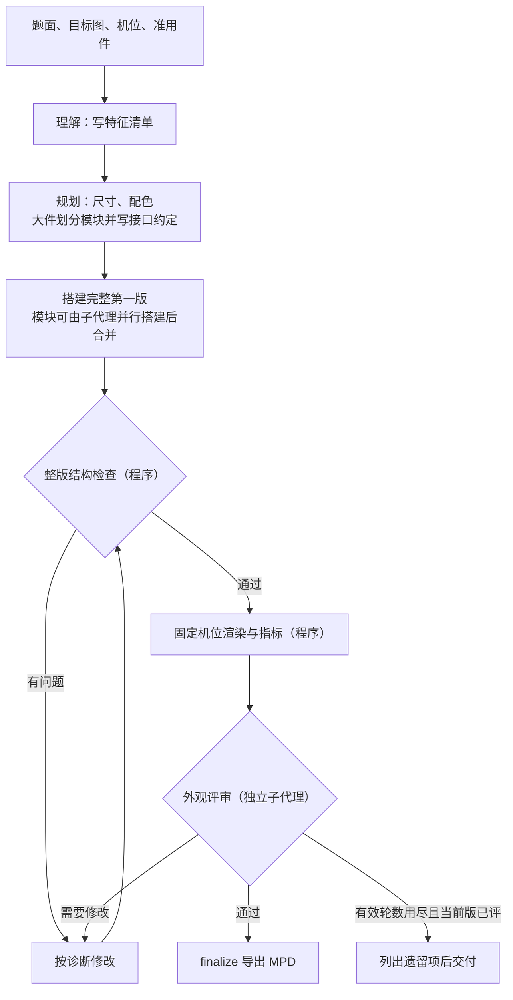

# 代理搭建流程总设计

**目标设计，待实施。** 本文给出从理解需求到交付模型的整体方案，P-004 至 P-006 由此派生。
P-007 另从基线暴露的接口缺口出发，验证标准 SDK 能否批量识别和恢复官方装配。各提案给出自己的实现取舍及验收。
对外的客户版设计稿另存于本地，与本文的流程一致。[范围](../decisions.md#u-06--以-omr36-演示完整搭建流程) · [模型](../decisions.md#u-07--演示统一使用-gpt-62-sol-medium)

## 1 目标与范围

在 OMR36 BrickWright 从零版第二版的六道题上演示完整流程：理解需求、规划、搭建、结构检查、外观评审、交付。
流程针对三项目标。

1. **装得对、装得上。** 零件按正确方式咬合，没有碰撞、悬空或未接上的部分。
2. **看得像。** 保留参考图和题面中让人认出对象的特征。
3. **大件能分块。** 大模型按接口约定拆成模块，可并行搭建后合并。

演示由 Codex 0.170.0 通过 `brickwright external` 驱动。主代理、子代理和评审代理均使用 `gpt-6.2-sol`，推理强度 medium。

本轮不做 LijuBrick 接入、真实照片输入和客户案例验收。实物的结构强度和拼装顺序不在检查范围内。
领导提出的“在限制模型能力的前提下”改善效果，本轮演示不能直接证明，见[第 10 节](#10-风险与起草前检查)。

## 2 评测与验收

评测集为工作区的 `brick-workspace/build/omr36-brickwright-v2`，六题均已通过 Maestro Oracle。
每题给出题面、五张固定机位目标图、`cameras.json`、准用件及色号表和件数上限。
`task.json` 的 `checks` 列出题面的完成条件。

| 题目 | 件数上限 | 参考解件数 | 参考解连通组件 |
| --- | --- | --- | --- |
| R-5521 Sea Jet 快艇 | 500 | 395 | 4 |
| R-21011 勃兰登堡门 | 460 | 362 | 1 |
| R-21020 特雷维喷泉 | 920 | 730 | 1 |
| R-31038 四季小屋 | 690 | 545 | 19 |
| R-31039 蓝色动力喷气机 | 770 | 613 | 1 |
| R-10258 伦敦双层巴士 | 2110 | 1684 | 14 |

平台核对有效定稿记录及其源码摘要、交付 MPD 与导出文件的字节一致性、原生报告的悬空和碰撞检查，再核对展开后的件数、准用件与颜色、位姿及上限。
交付检查通过后，平台分取五个机位上同色前景像素占并集比例的均值，并保留逐视图轮廓交并比和颜色分。
记录自带的 `connected` 检查可以指定期望组件数。标准目录重读交付件的连通性在本次归档后另行复核。

**对照方式。** 基线为当前 `develop` 的外部代理流程，新版为实现本设计后的流程。
两版使用相同的 Codex 版本、模型、推理强度、时限和每题运行次数，运行前冻结这些设置和评分规则。
第二版另传了只改时限的版本，每题 1 小时，巴士 2 小时；本次喷泉交付用了 21.2 分钟。
基线已用 `develop` 594effd 在该版本上每题运行一次。[基线运行](http://localhost:8420/runs/run_01m834xe645ngv8jjcmc40svmx)
新版只更换 BrickWright 附件，题目版本不变，以便按题对齐比较。
逐题记录以下内容。

- 交付检查是否通过，平台分，逐视图轮廓交并比和颜色分。
- 演示附件从题目原件传入每题三条 `task.json.checks`。人工盲评按这 18 条原文逐条记满足、未满足或证据不足，并标注视图或结构证据。
- 结构报告中主体以外的组件和仅靠接触支撑的零件（[第 6 节](#6-整版结构检查)）。
- 总耗时、模型用量，以及结构返修和外观返修的轮数。

拟议的全组通过条件为新版交付通过率、平台分均值和完成条件的满足数均不低于基线。喷气机另须由盲评确认指定区域在返修后更接近目标。若要对整组六题宣称外观改善，须在正式运行前另定全组的改善幅度与人工判定规则。
每版每题只跑一次时看不出波动，正式对照每版每题至少跑两次。
报告分别列出评审通过、轮数用尽且带遗留项交付、交付失败。巴士另设整体和分块两组，均启用 P-004/P-005；先验收独立搭建、接口与局部返工，再在同等质量下检验端到端墙钟是否缩短。

**基线结果。** 六题全部通过交付检查，平台分均值 0.568。代理用时 15.6–22.2 分钟，都未触及时限。

| 题目 | 交付件数 | 标准目录重读组件数 | 平均轮廓交并比 | 平台分 | 用时（分钟） |
| --- | ---: | ---: | ---: | ---: | ---: |
| R-5521 Sea Jet 快艇 | 282 | 1 | 0.852 | 0.414 | 15.6 |
| R-21011 勃兰登堡门 | 349 | 1 | 0.997 | 0.958 | 15.7 |
| R-21020 特雷维喷泉 | 881 | 1 | 0.968 | 0.702 | 21.2 |
| R-31038 四季小屋 | 544 | 8 | 0.918 | 0.524 | 22.2 |
| R-31039 蓝色动力喷气机 | 757 | 1 | 0.795 | 0.329 | 19.7 |
| R-10258 伦敦双层巴士 | 1007 | 5 | 0.860 | 0.482 | 19.0 |

**交付件复核。** 标准目录重读六份最终 MPD，件数均与报告相符，均为零碰撞、零悬空，四份连成一体。小屋 `run_tests()` 明定期望 8 个组件，成品为 507 件主体、31 件独立小车和六片单独的窗扇。巴士 `WheelRim.connectors` 在构建记录内把轮辋端点平移 2 LDU，记录内连通；标准目录重读得到 1003 件主体与四条轮胎。六题共调用 32 次 `validate`，各题第一次验证快照均失败过，最终的零碰撞、零悬空是返修后的结果。

**成品与目标图。** 喷气机 `empennage()` 用铰链搭出外倾双尾翼，端视可以看到，侧视边缘呈阶梯状。端视中机腹与进气口的截面、机翼相对机身的高度仍有可见偏差，轮廓交并比 0.640、颜色分 0.150。巴士 `bonnet()` 已搭出上盖、格栅和灯；端视中车头的宽窄变化和上层前角与目标不同，颜色分 0.203，侧视为 0.517。把两组目标与成品同机位并排，可检验评审是否指出了真实存在的偏差。勃兰登堡门则适合检查高分成品有无退步。

**代理行为。** 六题都试过按题目机位渲染或对照。巴士、城门、喷泉和快艇自写相机脚本，喷气机和小屋改用软件光栅器；各自的投影、缩放和颜色精度有别。五题成功打印了要求独立子代理的评审说明，轨迹中六题均无实际派发。每题只有一次试次，只能定位实例和检验工具能力，采用率变化、返修收益和波动仍需配对评测。

**复核入口。** 本地归档为 `.local/OMR36_BrickWright_v2_develop_594effd_Codex_baseline_1h_2h_budget-mc40svmx`。每题从 `tasks/<题号>/trial-1/attempt-1/` 进入。`verifier` 目录保存 `score-details.json` 和五张 `submission-*.png`，`artifacts/logs/artifacts/` 保存交付 MPD 和记录源码，`agent` 目录保存 `trajectory.json` 与 `codex.txt`。目标图与机位使用同一版题目输入。[基线运行与附件](http://localhost:8420/runs/run_01m834xe645ngv8jjcmc40svmx)

## 3 入口与共享层

BrickWright 有两条代理入口。`brickwright generate` 由内置循环经 LiteLLM 调用模型，
`brickwright external` 供 Codex、Claude Code 等外部代理调用。两者共用 BrickLayer、生成记录、
验证与导出工具、诊断和知识库。[架构](../architecture/overview.md)

本设计的新能力放在共享层。新产物存为记录中的文件，读写经过同一套校验。放行条件在记录和 `finalize` 中检查。
阶段顺序分别写入外部代理的流程说明和内置代理的提示，两条入口都能走完整流程。
演示只用外部入口，内置入口保持工具一致，不作为本轮验收对象。

记录在创建时选择是否启用本流程。未启用的记录和历史记录按现有规则验证和导出，
上游已有的视觉评审循环保持可用。

Codex 0.170.0 带有 `spawn_agent` 和 `wait_agent` 子代理工具，由多代理开关控制。
评审代理和模块搭建依赖它开启独立上下文。现有的[外部视觉评审说明](../../packages/brickwright/src/brickwright/driver/external_critique.py)已要求外部代理自行派出子代理。

## 4 流程与放行条件

| 阶段 | 执行者 | 产出 | 放行条件 |
| --- | --- | --- | --- |
| 理解 | 主代理 | 特征清单 | 格式有效；题面每条完成条件至少对应一项特征 |
| 规划 | 主代理 | 规划与接口约定 | 模块主体内部互不重叠；接口两端、允许伸入的空间及方向有归属 |
| 搭建 | 主代理，可加模块子代理 | `build.py`，模块记录 | 能创建模型 |
| 结构检查 | 程序 | 记录内结果与标准目录重读结果 | 两份均无碰撞和悬空，非主体组件按具体实例与接口解释，未知断开阻止交付；必需模块接口须证实接合 |
| 外观评审 | 程序渲染，独立评审代理 | 指标、逐项评审及遗漏 | 评审开始时冻结的输入仍有效；结论通过，或有效轮数用尽且列出遗留项 |
| 交付 | 程序 | LDraw MPD、预览、交付状态 | 交付与受检的整件快照、模块清单和 MPD 字节一致 |

结构检查必须先于外观评审。模型或合并清单改变会使结构报告和评审失效，特征、目标图或机位改变会使对应评审失效。
每次外观修改都要重新通过结构检查。评审轮数沿用现有外部评审的默认上限两轮，可按任务配置。
达到上限且当前版本有完整评审时可带遗留项交付。派发失败、未读图、重复回写或旧版本意见不消耗有效轮数。

外部代理可随时查询记录的流程状态。状态列出各产物是否存在、是否对应当前源码、哪项条件阻止导出，以及下一步可执行的命令。
`finalize` 被流程条件拒绝时，返回带原因码的诊断，格式与现有执行诊断一致。[代理收到的诊断](validation-and-export.md#代理收到的诊断)

## 5 记录中的新产物

现有记录已有 `build.py`、元数据、验证报告、快照、渲染图和视觉评审结果。[记录](../../packages/brickwright/src/brickwright/record.py)
本流程新增四类产物，均为 JSON 并带版本号，写入时校验格式，具体字段在提案中定稿。

**特征清单。** 附件直接载入原始完成条件并保留编号、原文和来源摘要。代理补充图上特征；每项包含编号、名称、类别（保留或拟议简化）、重要度（必须或尽量）、描述、依据和理由。
依据指向题面的完成条件或某张目标图及图中位置。有意简化的项写明简化方式，例如“侧墙小窗合并为三扇”。

**规划。** 包含整体尺度（目标包围范围，单位 LDU）、配色、有意分离的组件，以及可选的模块划分。
每个模块写明编号、占用范围、在整体中的原点和朝向、接口和共用颜色。
每个接口写明两端模块、连接类型、连接点在整体坐标中的位置和方向。

**结构报告。** 在现有验证报告上扩展，见[第 6 节](#6-整版结构检查)。

**评审报告。** 引用派发时冻结的整件模型、特征清单、原始题面、机位、目标图及成品图摘要。包含逐视图指标、差异区域、逐项结论及有依据的遗漏。
每项结论为保留、部分保留、缺失或已按约定简化，附图上证据和修改建议。最后给出“通过”或“需要修改”。

## 6 整版结构检查

现有验证在一次运行中检查碰撞和悬空，并执行记录自带的测试。悬空判定把接触支撑也算作有支撑，因此放在其他零件上而没有咬合的零件不会被报告。[验证实现](../../packages/brickwright/src/brickwright/tools/validation.py) · [悬空与连通组件](../../packages/bricklayer/src/bricklayer/modeling/build.py)

在本版 `develop` 上检查六题参考解，悬空和碰撞均为零，最大的巴士用时 1.4 秒。
但三题参考解不是单一连通组件：巴士有 14 个，四季小屋 19 个，Sea Jet 4 个。
初步查看，这些组件包括人仔部件、车内小件和挡风玻璃附件，尚未逐件区分端点数据缺项和有意的接触摆放。
因此“必须连成一体”不能作为放行条件。

整版结构检查保留碰撞和悬空两项放行条件，新增下列报告。

- **未咬合的组件。** 记录内检查后，使用冻结的标准目录重读待导出的 MPD，核对导入是否完整，两份结果并列。逐组件定位实例、预期配对面与接触件，区分规划中有意独立、已证实的具体接口数据缺项和原因未明的断开。只有匹配证据的接口可按 P-004 的规则处理，组件内另一件缺数据不能解释断开。
- **仅靠接触支撑的零件。** 作为提示列出，不阻止导出。
- **模块接口。** 有模块时检查每个约定接口在合并后是否形成连接，以及跨模块的碰撞。
- **运动检查。** 只在模型含关节时运行，沿用现有采样和诊断。

报告一次给出整版问题。同类问题较多时给出总数、可定位的样例和完整列表的位置，沿用 P-001 的诊断约定。
每条问题附原因码，可用 `brickwright knowledge search` 检索修复办法。

## 7 外观评审

**对齐渲染。** 题目给出机位时，按 `cameras.json` 的视点、目标点、上方向和视场角渲染，与目标图逐像素对齐。
验证器同样用 pygfx 和 ldraw2mesh 渲染，BrickWright 的渲染器基于同一套库。
没有给出机位时，沿用现有的视角匹配代理。[视角匹配](../../packages/brickwright/src/brickwright/driver/viewpoint.py)

**指标和差异区域。** 每个视图计算轮廓交并比和颜色分，口径与验证器一致。程序生成差异叠加图，
列出差异最大的若干区域。
先用六份参考解和六份归档成品逐视图校准，再接评审。首期以二维差异框定位，三维实例映射可后续补充。指标辅助定位，结论回到原始完成条件与目标图。

**评审代理。** 每轮由主代理派出一个新的子代理，只提供题面、目标图、特征清单、渲染图、指标和差异叠加图，
不提供 `build.py` 和搭建过程。评审代理逐项对照并补报清单遗漏的要求，说明依据来自哪张图的哪个位置。记录保存独立会话与图像输入凭据，按第 5 节绑定本轮报告。
评审代理不修改模型。

现有评审只返回一段差异描述和是否完成。[视觉评审](../../packages/brickwright/src/brickwright/driver/critique.py)
本设计在其基础上加入原始条件、特征清单、逐项依据及差异图，按派发时的快照拒收串版结果。
未写特征清单的记录继续使用原有评审。

**转为修改。** 每个未达成的特征项给出修改建议和相关区域。主代理修改后重新通过结构检查，再进入下一轮评审。

## 8 模块化搭建

规划阶段决定是否分块。划分以接口能否先定下来为准。例如巴士可先定底盘尺寸和车身固定点，再分出底盘、下层车身、上层车身和车顶。
本轮只在巴士上演示分块，其余五题整体搭建。

**模块记录。** 每个模块是父记录下的一条子记录，携带该模块的约定、共用配色和局部坐标系。
模块的 `build.py` 返回局部坐标中的 `LegoBuild`。

**模块自检。** 核对主体占用范围及只许指定销、轴或凸点伸入的接口空间，再查约定位置与方向上的接口可用性。
只有自检通过的模块才能交给合并。

**合并。** 父记录固定本次实际选择的模块快照、约定摘要及变换，`build.py` 按这份清单放置子模型。导出的 MPD 保留模块结构。
合并后做整版结构检查（第 6 节），包括模块接口。之后的外观评审针对整件进行。

**并行。** 外部入口由主代理为每个模块派出 Codex 子代理，各自在模块记录上工作。
内置入口的子代理派发现在只返回文本，需要扩展为可返回模块记录。[子代理派发](../../packages/brickwright/src/brickwright/tools/subagents.py)

**返工。** 修改某个接口时，按约定摘要使两端模块的自检失效，只返工受影响的模块。
父记录选用更新的子快照后重做合并、整件结构检查和评审。每个模块、合并及返工分别计时，并汇总主、子、评审代理用量。

## 9 派生提案

| 提案 | 内容 | 对应小节 |
| --- | --- | --- |
| [P-004 流程放行与记录产物](../proposals/P-004-flow-gates-and-records.md) | 流程开关和状态查询；特征清单、规划和评审报告的格式与读写；`finalize` 的放行条件；整版结构检查；两条入口的流程说明；基线和新版对照评测 | 2、3、4、5、6 |
| [P-005 对齐渲染与特征评审](../proposals/P-005-aligned-review.md) | 按给定机位渲染；指标和差异区域；评审代理的输入、输出和提示；评审结果转为修改建议 | 7 |
| [P-006 模块接口与分块搭建](../proposals/P-006-modular-building.md) | 模块记录、约定校验、模块自检、合并、跨模块检查、并行派发和返工 | 8 |

另有 [P-007 官方参考装配](../proposals/P-007-official-reference-assemblies.md) 负责接口族离线工程验收。演示可以使用 P-004 对未明断开的诊断；全库筛查可独立进行。

| 提案及依赖 | 验收材料 | 通过判据 |
| --- | --- | --- |
| P-004 读取原始题面、P-003 目录与 P-001 接口证据，向 P-005/P-006 提供快照和放行判断 | 六题原始条件、小屋与巴士归档、未知断开反例 | 18 条原文可核对，两份结构结果重现组件差异，缺少局部证据时拒绝放行 |
| P-005 消费 P-004 快照，写回独立评审 | 参考解与基线各 30 个视图，喷气机返修前后同机位证据 | 校准通过、独立代理实际读图、指出真实偏差，修改后同处可见改善，报告绑定正确版本 |
| P-006 向 P-004/P-005 交付固定的整件和接口证据 | 巴士模块快照、合并 MPD、局部返工及整体对照 | 不同代理独立完成，接口可复核、失效范围正确；另报同质量的墙钟、总用量和返工 |
| P-007 从 P-003 发布库提取正例，用 P-001 默认查询、试装，向 P-004 提供版本化复现 | 轮组清单与误接反例，随后全量筛查和第二种装配机制 | 首批成类修正与全组回归通过；全量条目能对账、已有判据的族均批跑，第二族实际走通 |
| P-001 运行时装配与代理行为 | SDK 的三类现场复现；另用 U-05 固定的新旧代理成品及盲评 | 工具给出可复核诊断；采用率、质量和完成度依原配对标准独立判定 |

## 10 风险与起草前检查

- **子代理。** 基线的 Codex 会话中已提供 `spawn_agent` 和 `wait_agent`，多代理模式为“仅在明确要求时使用”，六个试次都没有派子代理。
  新版须在运行环境认可的指令入口明确授权；烟测核对独立会话及实际读图。备用方案为独立模型调用与独立搭建进程，须记录实际派发路径及用量，保持 U-07 的模型设置。
- **未咬合组件的归因。** 参考解中的多组件需要逐接口分类。P-007 复核并修正同源缺口；未确证的现场断开在报告中保留。
- **指标同源。** 代理用的指标与平台分同源，分数上升可能只反映对指标的优化。验收同时看完成条件的人工判定。
- **模型能力。** 本轮全部使用 `gpt-6.2-sol` medium，不能说明较弱模型的表现。需要证明这一点时，另用内置入口和 LijuBrick 现用模型补跑。
- **分块收益。** 巴士只有约 1,700 件，分块后的合并和返工成本可能抵消并行节省的时间，结果按实测报告。
